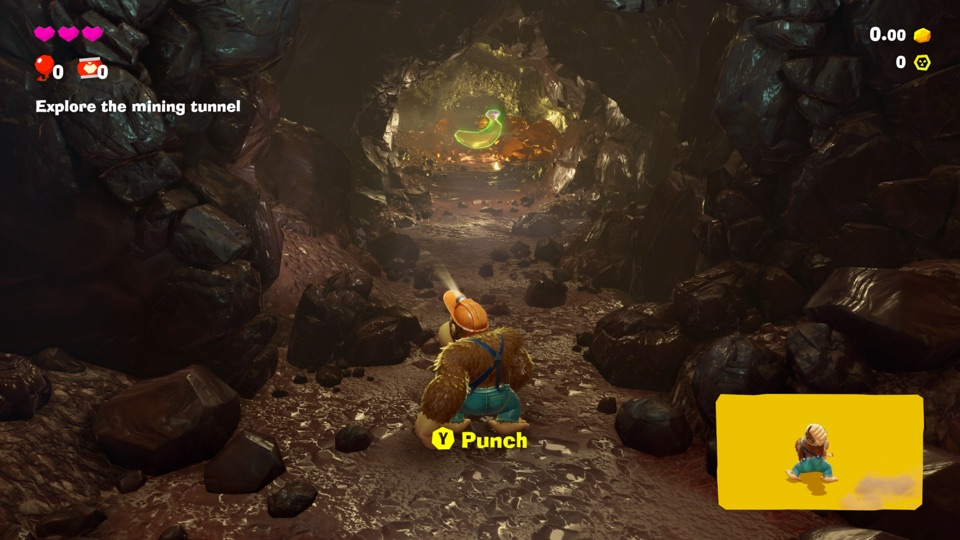

# Donkey Kong Bananza (`040074A01BF12000`)

Supported. This was the first game the app ran, and it is the app's default game. On the tested phone it holds 30 fps in the first level on both the system driver and Turnip, with stretches near 60. It needs a 16 GB phone to be comfortable.

## At a glance

| | |
|---|---|
| Status | Supported |
| Version | update 458752 |
| Frame rate | 30 fps (the game switches itself between 20, 30 and 60 by load) |
| Memory | 6.3 to 8.1 GB resident while playing on a 16 GB phone; the readiness check refuses a phone that reports under 10 GiB of RAM and warns under 14 GiB |
| Driver | system (Qualcomm) and Turnip both work |

## What was measured

On the tested phone (Snapdragon 8 Elite Gen 5, 16 GB), first level, frame generation off, Phone 1080p:

| GPU driver | Frame rate |
|---|---|
| System (Qualcomm) | 30 fps, with stretches of 55-58 |
| Turnip | 30 fps, with stretches of 49-59 |

Both are held at 30 fps by the CPU work of recording the frame; 60 fps is planned. Other phones: see [Tested devices](Tested-Devices).

## Settings that matter for this game

| Setting | What it does | When to toggle | What to expect | Default |
|---|---|---|---|---|
| Resolution (Game settings > Picture) | The size of the game's window: Original (2880x1620), Phone 1440p, 1080p, 720p, 540p or 480p. | Only if you want the game's own size. | In the author's measurements Original ran at about 30 fps against 52 fps for Phone 1080p when the GPU clocks were not capped, so it costs a lot. | Phone 1080p (1920x1080). This is the app's own default size for every game; this game's profile sets no default of its own. It was Phone 720p only in v0.1.2 |
| Aspect ratio | 21:9, 4:3, 10:9 or 1:1, plus Screen shape, for a wide or square screen such as a foldable. | On an unfolded foldable or an ultra-wide display. | The 3D camera and the heads-up display follow the shape. Full-screen menu backgrounds (the main menu) stay in the middle 16:9, so a 21:9 main menu shows flat strips at the sides. Speech bubbles above characters may sit closer to the middle than the character. | 16:9 |
| Frame rate cap (in-game panel) | Holds the game at 30 or 20 fps. 40, 45 and 15 are not offered. | To lower heat or steady the pace. | Game speed stays right at the lower rates. | Game's own |

See [Settings overview](Settings-Overview) and [Side panel in game](Side-Panel-In-Game) for where each setting is.

<!-- TODO screenshot: Game settings page of Donkey Kong Bananza (Picture section with Resolution and Aspect ratio) -->

## Known issues

- Busy scenes can drop the game to 30 fps for a few seconds, and cutscenes run at 20 fps by the game's own choice.
- Frame generation roughly doubles what is presented (title screen 60 to about 120 fps in one measurement). In the first level it took about 12.7 game fps to 25-26 presented in an early measurement; the game's own rate is unchanged. Under 10 game fps frame generation pauses until the rate is steady. See [Getting higher FPS](Getting-Higher-FPS).
- On the author's phone the first level was reached about 30 to 50 seconds after starting the game.
- Not tested past the first level's opening areas in the project's notes.

## Tips

- First start: let Prepare finish; see [First start and Prepare](First-Start-and-Prepare). The game has about 22,852 shaders.
- If your phone has under 14 GB of RAM, expect the app to warn you that Android may stop the game when memory runs short. Not measured yet on phones with less than 16 GB.
