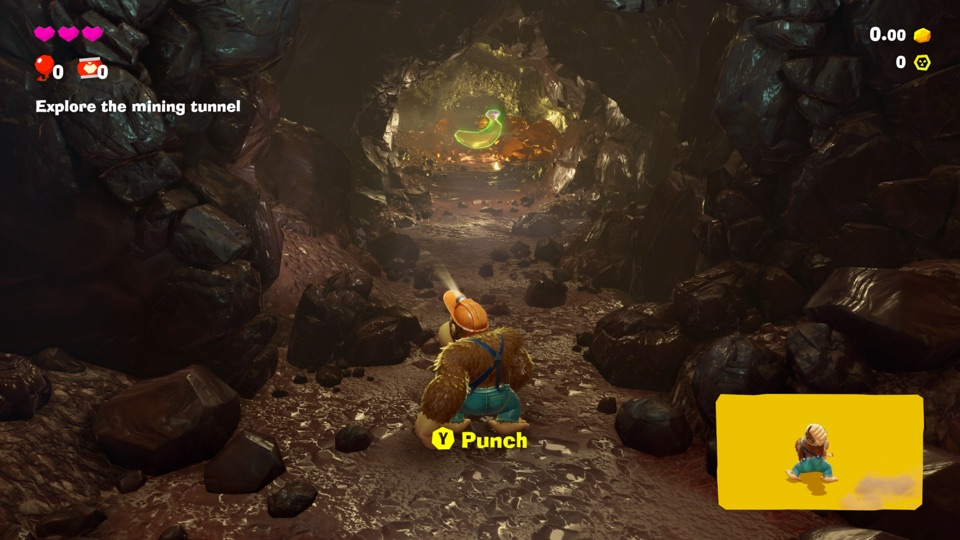

# Banana Native wiki

Banana Native runs Switch 2 games from your own dumps on Android phones. It emulates no hardware: the game's own ARM64 code runs on the phone's CPU, and Banana Native supplies the system services the game calls and translates its graphics to Vulkan. This wiki is for players: how to install, set up, play and fix things. It is unofficial and experimental, and not affiliated with Nintendo, nxnative or Eden.

## Start here

New? Follow the [Quick start](Quick-Start). New words are explained in the [Glossary](Glossary). The longer path:

1. Check the [requirements](Installation#what-you-need) (Android 13+, Snapdragon/Adreno GPU, 12 GB RAM or more).
2. [Install the app](Installation).
3. [Add and Prepare your game](First-Start-and-Prepare), once per game.
4. [Play](Playing).

## Pages

| Topic | Pages |
|---|---|
| Setup | [Quick start](Quick-Start), [Glossary](Glossary), [Installation](Installation), [First start and Prepare](First-Start-and-Prepare), [Updates](Updates) |
| Playing | [Playing](Playing), [Saves and storage](Saves-and-Storage), [GPU drivers](GPU-Drivers) |
| Settings and speed | [Settings overview](Settings-Overview), [Getting higher FPS](Getting-Higher-FPS), [Heat and battery](Heat-and-Battery), [Cheats](Cheats) |
| Games | [Games](Games) |
| Devices | [Device reports](Device-Reports), [Tested devices](Tested-Devices) |
| Problems | [Troubleshooting](Troubleshooting), [FAQ](FAQ) |

## Good to know

- The only official place is [git.eden-emu.dev/moceure/BananaNative](https://git.eden-emu.dev/moceure/BananaNative). Download the APK only from its [releases](https://git.eden-emu.dev/moceure/BananaNative/releases). The project has no Discord, subreddit, social media account or website, and nobody connected to it will ask you for money, keys or game files.
- The project takes only a dump folder (or a `.nup` file of one) that you made from your own console. It contains no Nintendo code, firmware or keys. Please don't ask for games, keys or dumps.
- Questions and reports go to [issues](https://git.eden-emu.dev/moceure/BananaNative/issues).
